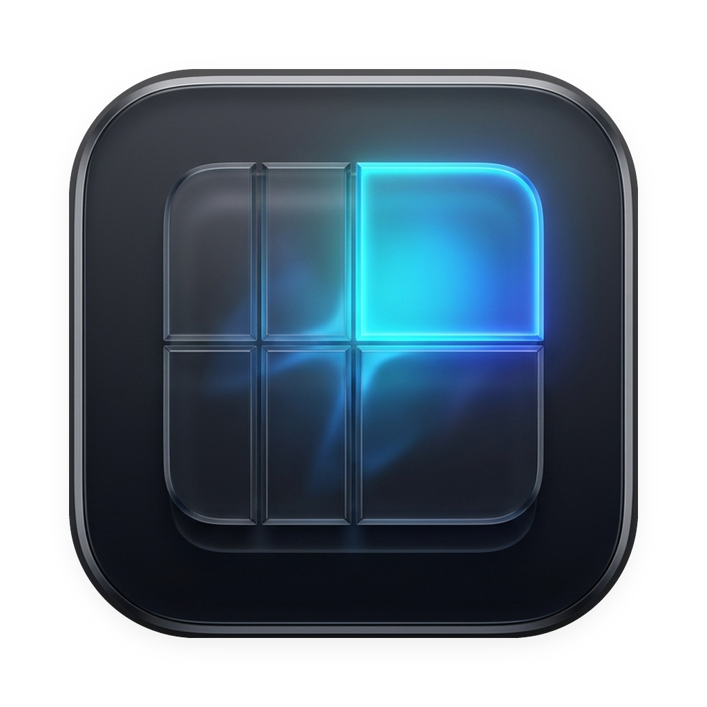

# Lattice 🪟

<p align="center">
  
</p>

<p align="center">
  <strong>優雅、極速、純原生 Swift 開發的 macOS 格線視窗管理工具</strong><br>
  <em>An elegant, ultra-fast, native Swift grid-based window manager for macOS.</em>
</p>

<p align="center">
  
  
  
  
</p>

<p align="center">
  <a href="https://github.com/aielainelin/lattice-macos/releases/latest/download/Lattice.dmg">
    
  </a>
</p>

---

## 📖 專案緣起 (Why Lattice?)

多年來，**Divvy**（由 Mizage 開發）一直是無數 Mac 使用者心中最順手、最直覺的視窗劃格管理軟體。然而，Divvy 是一款超過 10 年未更新的 Carbon 老舊 Intel 架構軟體，在現代 macOS（Sonoma、Sequoia）與 Apple Silicon (M 系列晶片) 上需仰賴 Rosetta 轉譯，甚至在近期系統更新後徹底失效閃退。

**Lattice** 是以純原生 **Swift 5.9 + AppKit + Accessibility API** 從零重寫的現代化開源解決方案：
- ⚡ **純原生極致效能**：啟動耗時 <0.1 秒，記憶體佔用極低（<20MB），無任何 Electron 或 WebKit 負擔。
- 🎨 **現代 macOS 毛玻璃視覺**：融入 macOS 現代風格的 HUD 懸浮介面與圓角設計。
- 🔒 **隱私安全**：純本機執行、零聯網權限、程式碼完全透明。

---

## ✨ 核心特色 (Features)

* **🎯 視覺化拖曳劃格 (Visual Grid HUD)**：
  按下全域快捷鍵（預設 `⌘⌥Space` 或 `⌃⌥Space`），立即在目前活躍視窗上方浮現毛玻璃格線，用滑鼠拖曳框選區域，放開即刻到位。
* **🥇 跨螢幕快速投遞 (Throw to Next / Prev Display)**：
  按下 `⌃⌥⌘→` 或 `⌃⌥⌘←`，直接將目前視窗「拋送」到隔壁顯示器，智慧保持相對位置與比例。
* **🥈 連續快捷鍵循環 (Repeated Hotkey Cycling)**：
  連按兩次左半快捷鍵（`⌘⇧←`），自動在 `1/2` ⇄ `2/3` ⇄ `1/3` 寬度之間循環切換；最大化（`⌘⇧↑`）連按可在全螢幕與上半屏切換。
* **🥉 HUD 數字鍵快速槽 (Quick Preset Slots 1~9)**：
  呼叫 HUD 後，直接按鍵盤數字 `1`~`9` 即可瞬間套用預設版面（如 `1` 為左 1/3，`4` 為左半，`7` 為左 2/3，`8` 為最大化，`5` 為置中），按 `Tab` 切換螢幕，兼顧盲打極速與視覺拖曳。
* **📐 動態切換網格維度**：
  支援在 HUD 下方即時切換 `4×4`、`6×6`、`8×8`、`10×10`，滿足筆電螢幕到 4K / 超寬曲面螢幕的細緻劃分需求。
* **🎛️ 留白與間隙自訂 (Margins & Gaps)**：
  支援自由設定螢幕邊界留白（Margins）與視窗間隔（Gaps），兼顧效率與桌面美感。

---

## ⌨️ 預設快捷鍵一覽 (Shortcuts)

### 1. 全域實體快捷鍵

| 快捷鍵 | 動作 | 連按循環效果 (1.3s 內) |
|---|---|---|
| `⌘ ⌥ Space` / `⌃ ⌥ Space` | **呼叫 / 關閉 Lattice HUD** | 再次按下或按 `Esc` 關閉 |
| `⌘ ⇧ ←` | **靠左配置** | `1/2 寬度` ⇄ `2/3 寬度` ⇄ `1/3 寬度` |
| `⌘ ⇧ →` | **靠右配置** | `1/2 寬度` ⇄ `2/3 寬度` ⇄ `1/3 寬度` |
| `⌘ ⇧ ↑` | **視窗最大化** | `最大化` ⇄ `上半螢幕 (Top Half)` ⇄ `下半螢幕` |
| `⌘ ⇧ ↓` | **視窗置中** | `中型置中 (~66%)` ⇄ `大型置中 (~85%)` ⇄ `小巧置中 (~50%)` |
| `⌃ ⌥ ⌘ →` | **跨螢幕投遞 (下一個)** | 將目前視窗拋送到下一台顯示器並等比縮放 |
| `⌃ ⌥ ⌘ ←` | **跨螢幕投遞 (上一個)** | 將目前視窗拋送到上一台顯示器並等比縮放 |

### 2. HUD 開啟時的單鍵快速盲打

| 按鍵 | 動作說明 | 對應格線區域 |
|---|---|---|
| `1` / `2` / `3` | **三分屏 (Thirds)** | 左側 1/3 / 中間 1/3 / 右側 1/3 |
| `4` / `6` | **半屏 (Halves)** | 左半螢幕 (50%) / 右半螢幕 (50%) |
| `7` / `9` | **雙倍三分屏 (Two-Thirds)** | 左側 2/3 (66%) / 右側 2/3 (66%) |
| `8` 或 `Space` | **鋪滿全螢幕** | 最大化佔滿全部網格 |
| `5` 或 `C` | **焦點置中** | 視窗居中適中大小 |
| `Tab` 或 `N` | **切換目標螢幕** | HUD 與劃格輪替至下一個顯示器 |
| `Esc` | **退出** | 關閉 HUD，不改變視窗 |

> 💡 **提示**：除了快捷鍵，也可以隨時點擊選單列（Menu Bar）上的 Lattice 圖示開啟 HUD 或進入偏好設定。

---

## 🚀 安裝與建置 (Installation)

### 系統需求
- **作業系統**：macOS 14.0 (Sonoma) 或 macOS 15.0+ (Sequoia)
- **硬體晶片**：Apple Silicon (M1/M2/M3/M4 系列) 或 Intel Mac

### 快速建置並安裝 (One-line Build & Install)

在終端機中執行以下指令：

```bash
# 1. 複製專案
git clone https://github.com/aielainelin/lattice-macos.git
cd lattice-macos

# 2. 自動編譯並安裝至 /Applications
./build.sh --install
```

編譯完成後，`Lattice.app` 會自動安裝至 `/Applications/` 並啟動。

---

## ⚠️ 初次安裝者必看：macOS 權限設定指南 (Important Setup Note)

視窗管理工具依賴 macOS 的 **「輔助使用」（Accessibility）** 權限來調整其他 App 視窗大小。由於 macOS 嚴格的 TCC 安全沙盒機制，**請特別注意以下設定細節**：

### 🚨 常見問題：開關已經是開啟的，為什麼視窗還是沒反應？
這是 macOS 的已知機制（Cache Invalidation）：
當本機重新編譯或手動替換開源二進位檔時，macOS 底層會判定簽名雜湊改變而註銷權限；但 **系統設定介面中的開關仍會顯示為亮藍色（開啟狀態）**，造成「明明有開卻無法控制」的假象。

### ✅ 正確設定步驟：
1. 打開 **「系統設定」 (System Settings)**。
2. 進入 **「隱私權與安全性」 > 「輔助使用」 (Privacy & Security > Accessibility)**。
3. 在右側清單中找到 **Lattice**：
   - 點選 Lattice，按下方的 **「-」減號** 徹底將其從清單中移除（**重要：請勿只是關閉再重開**）。
   - 按下方的 **「+」加號**，瀏覽至 `/Applications/Lattice.app` 重新加入。
4. 確認開關為 **開啟** 狀態。
5. （終端機一鍵重置法）：
   ```bash
   tccutil reset Accessibility com.fontour.lattice
   ```
   執行後重新開啟 Lattice，系統會彈出全新授權視窗，點擊「允許」即可。

---

## 📁 專案架構 (Architecture)

```text
Lattice/
├── assets/                  # 應用程式高解析度圖示與文件資源
│   └── icon.png
├── src/                     # Swift 原生核心原始碼
│   ├── main.swift           # CLI 參數解析與主進入點
│   ├── AppDelegate.swift    # 應用程式生命週期管理
│   ├── WindowManager.swift  # Quartz & Accessibility 視窗控制核心
│   ├── GridHUD.swift        # 毛玻璃懸浮劃格面板與互動事件
│   ├── HotKeyManager.swift  # Carbon 全域底層快捷鍵監聽
│   ├── StatusBarController.swift # 選單列選單與狀態控制器
│   ├── SettingsWindow.swift # 偏好設定介面
│   ├── Preferences.swift    # UserDefaults 設定持久化
│   └── Logger.swift         # 本機輕量日誌系統 (/tmp/lattice.log)
├── AppIcon.icns             # macOS 應用程式打包圖示
├── Info.plist               # 應用程式元數據與權限描述
├── build.sh                 # 自動編譯、簽名與安裝腳本
├── .gitignore
├── LICENSE                  # MIT License
└── README.md
```

---

## 💡 未來路線圖與功能進度 (Roadmap)

- [x] 🥇 **跨螢幕投遞快捷鍵 (Throw to Next Display)**：按下 `⌃⌥⌘→` / `⌃⌥⌘←` 將目前視窗拋送到下一台螢幕並等比適配。
- [x] 🥈 **快捷鍵重複循環 (Repeated Hotkey Cycling)**：連按 `⌘⇧←` 或 `⌘⇧→` 自動在 `1/2` ⇄ `2/3` ⇄ `1/3` 間切換。
- [x] 🥉 **HUD 數字鍵快速槽 (Quick Slot Presets 1~9)**：呼叫 HUD 後按鍵盤數字 `1`~`9` 瞬間套用預設網格。
- [ ] 視窗邊界磁吸 (Edge Snapping)
- [ ] 自訂各個顯示器獨立網格尺寸
- [ ] Homebrew Cask 發布支援 (`brew install --cask lattice`)

---

## 📄 開源授權 (License)

本專案採用 [MIT License](LICENSE) 授權，歡迎自由修改、分發與貢獻程式碼。
